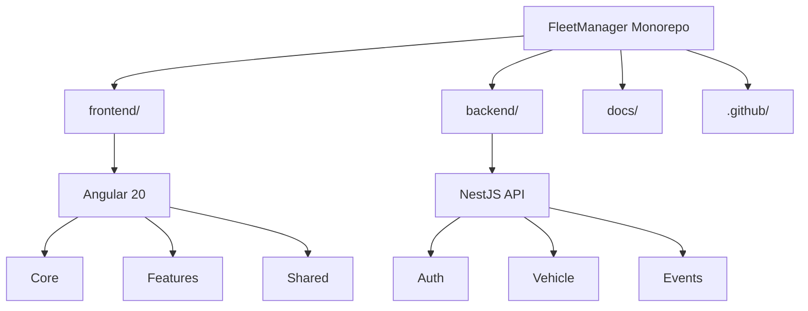

# Architecture

Back to the [README](../README.md#architecture).

## Table of Contents

- [Architecture](#architecture)
  - [Table of Contents](#table-of-contents)
  - [Repository Layout](#repository-layout)
  - [Frontend Architecture](#frontend-architecture)
  - [Core](#core)
  - [Features](#features)
  - [Shared](#shared)
  - [Project Structure](#project-structure)
    - [Frontend Structure](#frontend-structure)
    - [Backend Structure](#backend-structure)

---

## Repository Layout

Fleet Manager is a monorepo with two independent applications that share the documentation and the GitHub configuration:

```text
FleetManager/
├─ frontend/    # Angular application
├─ backend/     # NestJS API
├─ docs/        # Project documentation
├─ .github/     # Issue and pull request templates
├─ README.md
└─ LICENSE
```

The following diagram provides a high-level overview of the repository structure and the main architectural areas of each application.



The decisions behind this structure are documented in [ADR 0001](decisions/0001-monorepo-structure.md). The rest of this guide describes the architecture of the frontend application.

## Frontend Architecture

Fleet Manager follows a **feature-based architecture**, where the application is organized by business domains instead of grouping files only by their technical role. This approach keeps related functionality together, making the codebase easier to understand, maintain, and extend.

The application is divided into three main areas:

## Core

The `core` folder contains application-wide infrastructure that is shared across the entire application. These elements are created once and are not tied to a specific business feature.

Examples include:

- Global layout components such as the header, navigation, account drawer and notification interface.
- Route guards for authentication and guest access.
- Cross-cutting services such as authorization, data source management, geolocation, theme management and layout messages.

## Features

The `features` folder contains the application's business domains. Each feature is self-contained and groups together everything required for that area of functionality.

Depending on its needs, a feature owns its:

- Pages.
- Components.
- Data-access services.
- State management.
- Routes.
- Domain models, interfaces, enums and other feature-specific resources.

For example:

- `auth` manages authentication and registration.
- `vehicle` contains vehicle management functionality.
- `invitations` manages vehicle access invitations and their statuses.
- `map` provides the interactive map experience.
- `calendar` manages vehicle usage scheduling.
- `graphics` contains the statistics dashboard.

Internationalization message services are also organized within individual features to keep their messages close to the functionality they support.

Keeping these resources together allows each feature to evolve independently while reducing coupling between different parts of the application.

## Shared

The `shared` folder contains reusable building blocks that are not specific to any single feature.

This includes:

- Reusable UI components, such as buttons.
- Generic modal components.

Resources placed in `shared` are intended to be reused across multiple features without containing business-specific logic.

## Project Structure

Fleet Manager is organized as a monorepo containing two independent applications: an Angular frontend and a NestJS backend. Each application has its own source code, dependencies, configuration, and development commands.

### Frontend Structure

The following structure is relative to the `frontend/` directory and shows the main source files of the Angular application.

```text
src/
├─ app/
│  ├─ core/                         # Global application infrastructure
│  │  ├─ guards/                    # Authentication and guest guards
│  │  ├─ layout/                    # Header, navigation, account drawer, notifications
│  │  └─ services/                  # Shared application services
│  │
│  ├─ features/                     # Main application features
│  │  ├─ auth/                      # Login, registration and authentication
│  │  ├─ calendar/                  # Events and scheduling (FullCalendar)
│  │  ├─ graphics/                  # Statistics and data visualization (Chart.js)
│  │  ├─ invitations/               # Vehicle access invitations
│  │  ├─ map/                       # Interactive map (Leaflet)
│  │  └─ vehicle/                   # Vehicle management, access and permissions
│  │
│  ├─ shared/                       # Reusable UI components
│  │  └─ ui/                        # Buttons and generic modals
│  │
│  ├─ app.config.ts
│  ├─ app.routes.ts
│  ├─ app.html
│  ├─ app.scss
│  └─ app.ts
│
├─ assets/
│  ├─ icons/
│  └─ readme/
│
├─ environments/                    # Environment configurations
│  ├─ environment.development.ts    # Development environment configuration
│  └─ environment.ts                # Default environment configuration
│
├─ styles/                          # Global SCSS styling system
│  ├─ abstracts/                    # Variables and mixins
│  ├─ base/                         # Base styles and typography
│  ├─ themes/                       # Light and dark themes
│  ├─ tokens/                       # Design tokens
│  └─ utilities/                    # SCSS helpers
│
├─ index.html
├─ main.ts
└─ styles.scss
```

The frontend follows a feature-based architecture. The `core` directory contains application-wide infrastructure, `features` groups functionality by business domain, and `shared` contains reusable UI components. This separation keeps related functionality together and makes the application easier to maintain and extend.

### Backend Structure

The following tree shows the main modules and configuration files of the NestJS API. Paths are relative to the repository root, with `backend/` as the API's root directory.

```text
backend/
├─ src/
│  ├─ auth/                # Authentication and Firebase integration
│  ├─ events/              # Event management
│  ├─ vehicle/             # Vehicle management
│  ├─ app.controller.ts
│  ├─ app.module.ts
│  ├─ app.service.ts
│  └─ main.ts
│
├─ test/                    # End-to-end tests
├─ .env                    # Local environment variables (not committed)
├─ .env.example             # Environment variable template
├─ package.json
├─ nest-cli.json
└─ tsconfig.json
```

The backend follows NestJS's modular architecture, with separate modules for authentication, events, and vehicle management. Each module groups the components required for its functionality, such as controllers, services, DTOs, and schemas.

The `dist/` directory contains generated build output and is not part of the source structure. The `.env` file contains local environment variables and is excluded from version control, while `.env.example` documents the required environment variables without exposing real credentials.

---

[↑ Back to top](#architecture)
