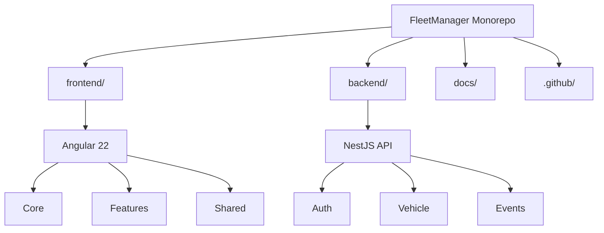
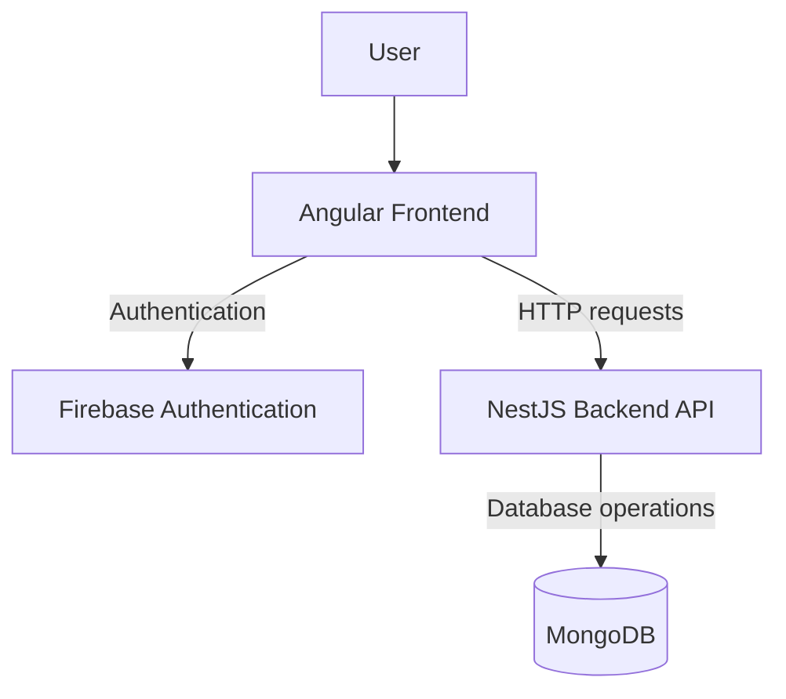

# Architecture

Back to the [README](../README.md#architecture).

## Table of Contents

- [Architecture](#architecture)
  - [Table of Contents](#table-of-contents)
  - [Repository Layout](#repository-layout)
  - [System Architecture](#system-architecture)
  - [Frontend Architecture](#frontend-architecture)
    - [Core](#core)
    - [Features](#features)
    - [Shared](#shared)
  - [Project Structure](#project-structure)
    - [Frontend Structure](#frontend-structure)
    - [Backend Structure](#backend-structure)

## Repository Layout

Fleet Manager is a monorepo with two independent applications that share the documentation and the GitHub configuration:

```text
FleetManager/
├─ frontend/          # Angular application
├─ backend/           # NestJS API
├─ docs/              # Project documentation
├─ .github/           # Issue and pull request templates
├─ README.md
├─ CONTRIBUTING.md
├─ CONTRIBUTORS.md
├─ SECURITY.md
└─ LICENSE
```

The following diagram provides a high-level overview of the repository structure and the main architectural areas of each application.



The architectural decisions behind Fleet Manager are documented as Architecture Decision Records (ADRs). The [ADR index](decisions/index.md) provides a centralized overview of all documented decisions, including their status and date.

The planned architectural improvements are tracked in the [project roadmap](roadmap.md).

The rest of this guide describes the architecture of the frontend application.

## System Architecture

Fleet Manager consists of an Angular frontend, a NestJS backend API, Firebase Authentication, and MongoDB. The frontend communicates with the backend through HTTP requests, while Firebase Authentication handles user authentication and MongoDB stores application data.

The following diagram illustrates the main components and their relationships.



The frontend and backend maintain separate dependencies, configurations, and development commands. Firebase Authentication handles user identity, while the backend is responsible for API operations and data persistence.

## Frontend Architecture

Fleet Manager follows a **feature-based architecture**, where the application is organized by business domains instead of grouping files only by their technical role. This approach keeps related functionality together, making the codebase easier to understand, maintain, and extend.

The application is divided into three main areas:

### Core

The `core` folder contains application-wide infrastructure that is shared across the entire application. These elements are created once and are not tied to a specific business feature.

Examples include:

- Global layout components such as the header, navigation, account drawer, notification interface and the layout messages (i18n) service.
- Route guards for authentication and guest access.
- Cross-cutting services such as authorization, data source management, geolocation, theme management and vehicle access.

### Features

The `features` folder contains the application's business domains. Each feature is self-contained and groups together everything required for that area of functionality.

Depending on its needs, a feature owns its:

- Pages.
- Components.
- Data-access services.
- State management.
- Routes.
- Domain models, interfaces, enums and other feature-specific resources.

For example:

- `auth` manages authentication and registration.
- `vehicle` contains vehicle management functionality.
- `invitations` manages vehicle access invitations and their statuses.
- `map` provides the interactive map experience.
- `calendar` manages vehicle usage scheduling.
- `graphics` contains the statistics dashboard.

Internationalization message services are also organized within individual features to keep their messages close to the functionality they support.

Keeping these resources together allows each feature to evolve independently while reducing coupling between different parts of the application.

### Shared

The `shared` folder contains reusable building blocks that are not specific to any single feature.

This includes:

- Reusable UI components, such as buttons.
- Generic modal components.
- Messages (i18n) service for the shared UI components.

Resources placed in `shared` are intended to be reused across multiple features without containing business-specific logic.

## Project Structure

Fleet Manager is organized as a monorepo containing two independent applications: an Angular frontend and a NestJS backend. Each application has its own source code, dependencies, configuration, and development commands.

### Frontend Structure

The following structure is relative to the `frontend/` directory and shows the main source files of the Angular application.

```text
src/
├─ app/
│  ├─ core/                         # Global application infrastructure
│  │  ├─ guards/                    # Authentication and guest guards
│  │  ├─ layout/                    # Header, navigation, account drawer, notifications and messages
│  │  └─ services/                  # Shared application services
│  │
│  ├─ features/                     # Main application features
│  │  ├─ auth/                      # Login, registration and authentication
│  │  ├─ calendar/                  # Events and scheduling (FullCalendar)
│  │  ├─ graphics/                  # Statistics and data visualization (Chart.js)
│  │  ├─ invitations/               # Vehicle access invitations
│  │  ├─ map/                       # Interactive map (Leaflet)
│  │  └─ vehicle/                   # Vehicle management, access and permissions
│  │
│  ├─ shared/                       # Reusable UI components
│  │  └─ ui/                        # Buttons, generic modals and shared UI messages
│  │
│  ├─ app.config.ts
│  ├─ app.routes.ts
│  ├─ app.html
│  ├─ app.scss
│  └─ app.ts
│
├─ assets/
│  └─ icons/
│
├─ environments/                    # Environment configurations
│  ├─ environment.development.ts    # Development environment configuration
│  └─ environment.ts                # Default environment configuration
│
├─ styles/                          # Global SCSS styling system
│  ├─ abstracts/                    # Variables and mixins
│  ├─ base/                         # Base styles and typography
│  ├─ themes/                       # Light and dark themes
│  ├─ tokens/                       # Design tokens
│  └─ utilities/                    # SCSS helpers
│
├─ index.html
├─ main.ts
└─ styles.scss
```

The frontend follows a feature-based architecture. The `core` directory contains application-wide infrastructure, `features` groups functionality by business domain, and `shared` contains reusable UI components. This separation keeps related functionality together and makes the application easier to maintain and extend.

### Backend Structure

The following tree shows the main modules and configuration files of the NestJS API. Paths are relative to the repository root, with `backend/` as the API's root directory.

```text
backend/
├─ src/
│  ├─ auth/                    # Authentication
│  │  ├─ firebase/             # Firebase Admin service and module
│  │  │  ├─ firebase.module.ts
│  │  │  └─ firebase.service.ts
│  │  ├─ auth.controller.ts
│  │  ├─ auth.module.ts
│  │  ├─ authenticated-request.ts
│  │  ├─ current-user.decorator.ts
│  │  └─ firebase-auth.guard.ts
│  ├─ common/                  # Cross-cutting concerns
│  │  ├─ errors/               # Global exception filter and error mapping
│  │  ├─ pipes/                # Mongo id validation pipe
│  │  ├─ testing/              # Shared test helpers (excluded from the build)
│  │  └─ validation-pipe-options.ts
│  ├─ config/                  # Environment variables and their validation
│  ├─ events/                  # Event management
│  │  ├─ dtos/                 # Create and update DTOs
│  │  ├─ schemas/              # MongoDB schema
│  │  ├─ event-time.ts         # Date and time rules
│  │  ├─ events.controller.ts
│  │  ├─ events.module.ts
│  │  └─ events.service.ts
│  ├─ vehicle/                 # Vehicle management
│  │  ├─ access/               # Shared logic that decides which vehicles a user can access
│  │  │  ├─ vehicle-access.module.ts
│  │  │  └─ vehicle-access.service.ts
│  │  ├─ dtos/                 # Create, update, location and share DTOs
│  │  ├─ schemas/              # MongoDB schema
│  │  ├─ vehicle-sharing.service.ts
│  │  ├─ vehicle.controller.ts
│  │  ├─ vehicle.module.ts
│  │  └─ vehicle.service.ts
│  ├─ app.controller.ts
│  ├─ app.module.ts
│  ├─ app.service.ts
│  └─ main.ts
│
├─ test/                       # End-to-end tests
│  ├─ support/                 # In-memory database, fake Firebase and helpers
│  ├─ app.e2e-spec.ts
│  ├─ auth.e2e-spec.ts
│  ├─ events.e2e-spec.ts
│  ├─ vehicles.e2e-spec.ts
│  ├─ jest-e2e.json
│  └─ tsconfig.e2e.json
├─ .env                        # Local environment variables (not committed)
├─ .env.example                # Environment variable template
├─ package.json
├─ nest-cli.json
├─ tsconfig.build.json
├─ tsconfig.json
└─ tsconfig.spec.json
```

Unit tests (`*.spec.ts`) are located next to the code they test, and the end-to-end tests live in `test/` (see the [Testing Guide](testing.md)). The tree omits the specs and some configuration files for brevity.

The backend follows NestJS's modular architecture, with separate modules for authentication, vehicles and events. Each module groups the components required for its functionality, such as controllers, services, DTOs and schemas. Controllers only delegate to services.

**Module boundaries**

- `FirebaseModule` is global. It initializes Firebase Admin from the validated configuration and exposes token verification and user lookup by email.
- `VehicleAccessModule` owns the rule that decides which vehicles a user can access (the owner and the users the vehicle is shared with). The vehicle and events services both use it, so the rule exists in a single place.
- `VehicleModule` depends on `EventsModule` to delete the events of a deleted vehicle. The dependency goes only from vehicles to events, so there are no circular module dependencies.
- `VehicleSharingService` handles sharing and unsharing a vehicle, keeping that logic out of the controller.

**Request pipeline**

1. The configuration is validated when the application starts. A missing or invalid environment variable stops the startup with an explicit message.
2. `FirebaseAuthGuard` verifies the Bearer token of every request to the vehicle and events routes.
3. The global `ValidationPipe` validates and cleans the request bodies, and `ParseMongoIdPipe` rejects invalid ids in the route parameters.
4. Controllers delegate to services, which apply the authorization rules.
5. A global exception filter keeps the response of HTTP exceptions, maps database errors to proper status codes (409 and 400) and hides the details of unexpected errors.

**Authorization rules**

- The owner of a vehicle can edit all its fields, share it and delete it.
- Users the vehicle is shared with can see it, update only its location and remove themselves.
- Every user with access to a vehicle can create, edit and delete its events. Users without access receive 404.

The decisions behind these rules and the module boundaries are recorded in [ADR 0004](decisions/0004-backend-authorization-and-module-boundaries.md).

The `dist/` directory contains generated build output and is not part of the source structure. The `.env` file contains local environment variables and is excluded from version control, while `.env.example` documents the required environment variables without exposing real credentials.

---

[↑ Back to top](#architecture)
